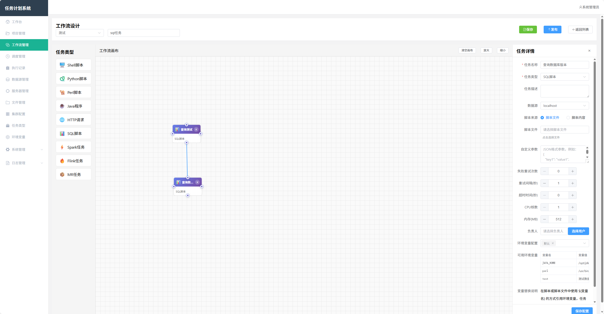

# 任务计划工具箱系统

参照 **Apache DolphinScheduler** 设计的企业级任务计划管理系统，支持可视化工作流编排、任务调度、远程执行、日志追踪等核心功能。

## 项目概述

### 技术栈

| 层级 | 技术 | 版本 |
|------|------|------|
| 前端 | Vue | 3.4.21 |
| 前端 | TypeScript | 5.4.5 |
| 前端 | Vite | 4.5.14 |
| 前端 | Element Plus | 2.6.3 |
| 后端 | Spring Boot | 2.7.14 |
| 后端 | Quartz | 2.3.2 |
| 后端 | Spring Data JPA | 2.7.12 |
| 数据库 | MySQL | 5.7+ / 8.0+ |

### 架构设计

```
┌─────────────────────────────────────────────────────────────┐
│                      前端层 (Vue 3)                        │
│  ┌─────────┐ ┌──────────┐ ┌─────────┐ ┌─────────────────┐  │
│  │ 工作流设计│ │ 任务管理 │ │ 调度管理│ │   系统管理      │  │
│  └────┬────┘ └────┬─────┘ └────┬────┘ └────────┬────────┘  │
└───────┼───────────┼────────────┼───────────────┼───────────┘
        │           │            │               │
        ▼           ▼            ▼               ▼
┌─────────────────────────────────────────────────────────────┐
│                      API网关层                             │
│              Spring Security + JWT认证                      │
└─────────────────────────────────────────────────────────────┘
        │
        ▼
┌─────────────────────────────────────────────────────────────┐
│                      业务逻辑层                             │
│  ┌─────────────┐ ┌─────────────┐ ┌─────────────────────┐   │
│  │ProcessService│ │ TaskService │ │ ScheduleService    │   │
│  │WorkflowService││ AuthService │ │SystemConfigService │   │
│  └─────────────┘ └─────────────┘ └─────────────────────┘   │
└─────────────────────────────────────────────────────────────┘
        │
        ▼
┌─────────────────────────────────────────────────────────────┐
│                      数据访问层                             │
│              Spring Data JPA + MySQL                       │
└─────────────────────────────────────────────────────────────┘
        │
        ▼
┌─────────────────────────────────────────────────────────────┐
│                      基础设施层                             │
│  MySQL (数据存储)  │  Quartz (调度引擎)  │  文件存储         │
│  SSH (远程执行)    │  Redis (缓存)      │  日志系统         │
└─────────────────────────────────────────────────────────────┘
```

## 功能截图

### 系统登录页面


### 工作流设计器


### 调度管理


### 文件管理


### 执行记录


### 任务执行日志


### 用户管理


## 核心功能模块

### 1. 工作流设计模块
- **可视化DAG工作流设计器**：拖拽式任务节点添加
- **任务节点连线**：支持节点间依赖关系配置
- **任务详情编辑**：双击节点打开编辑面板
- **多任务类型支持**：Shell、Python、Java、SQL、Spark、Flink、HTTP等
- **脚本文件选择**：支持从文件管理中选择脚本文件
- **版本管理**：工作流版本自动递增、历史版本对比与回滚

### 2. 任务管理模块
- 任务定义管理（创建/编辑/删除）
- 任务类型配置管理
- 脚本文件管理（上传/预览/编辑）
- 数据源配置管理（MySQL、PostgreSQL、Oracle等）
- 环境变量配置管理

### 3. 调度管理模块
- **Cron表达式调度**：支持标准Quartz 6-field格式
- **图形化Cron编辑器**：可视化配置调度时间
- **调度计划管理**：创建、编辑、删除调度计划
- **调度状态控制**：启用/禁用调度，同步Quartz调度计划
- **立即执行**：手动触发工作流执行
- **执行日志查看**：查看调度执行记录

### 4. 执行管理模块
- **工作流实例管理**：查看实例状态、执行时间
- **任务实例管理**：查看各任务节点执行情况
- **执行日志追踪**：完整的任务执行日志记录
- **失败重试机制**：支持失败任务重试
- **远程执行**：支持SSH远程服务器任务执行

### 5. 资源管理模块
- **项目管理**：项目创建、配置
- **文件资源管理**：目录树展示、文件上传、在线编辑
- **环境变量配置**：多组配置值管理、支持配置名称分组

### 6. 系统管理模块
- **用户管理**：CRUD操作、角色分配
- **角色管理**：角色创建、权限配置
- **菜单管理**：动态菜单配置
- **服务器节点管理**：SSH连接配置、状态监控
- **系统配置管理**：系统参数配置

### 7. 日志管理模块
- **调度日志**：调度计划执行记录
- **任务执行日志**：任务执行输出日志
- **日志检索**：按实例ID、任务类型、时间范围筛选

## 项目结构

```
task-plan/
├── backend/                              # 后端Spring Boot项目
│   ├── src/main/java/com/taskplan/       # Java源码
│   │   ├── controller/                   # REST API控制器
│   │   ├── service/                      # 业务逻辑层
│   │   ├── repository/                   # 数据访问层
│   │   ├── entity/                       # JPA实体
│   │   ├── config/                       # 配置类
│   │   ├── exception/                    # 异常处理
│   │   └── utils/                        # 工具类
│   ├── src/main/resources/               # 配置文件
│   ├── uploads/                          # 文件上传目录
│   └── pom.xml                           # Maven配置
├── frontend/                             # 前端Vue项目
│   ├── src/
│   │   ├── views/                        # 页面视图
│   │   ├── components/                   # 公共组件
│   │   ├── layout/                       # 布局组件
│   │   ├── router/                       # 路由配置
│   │   ├── api/                          # API接口定义
│   │   └── utils/                        # 工具函数
│   └── package.json                      # npm依赖
├── docs/                                 # 文档目录
│   ├── design.md                         # 设计文档
│   ├── api.md                            # API文档
│   ├── usage.md                          # 使用说明
│   └── 开发计划.md                       # 开发计划
├── images/                               # 截图目录
├── backend/init-db.sql                   # 数据库初始化脚本
└── README.md                             # 项目说明
```

## 快速开始

### 前置要求

- JDK 1.8+
- Node.js 18+
- MySQL 5.7+ 或 MySQL 8.0+

### 数据库配置

1. 创建数据库：
```sql
CREATE DATABASE task_plan_db CHARACTER SET utf8mb4 COLLATE utf8mb4_unicode_ci;
```

2. 执行初始化脚本：
```bash
mysql -u username -p task_plan_db < backend/init-db.sql
```

### 后端启动

```bash
cd backend
mvn spring-boot:run
```

服务启动后访问：http://localhost:8080

### 前端启动

```bash
cd frontend
npm install
npm run dev
```

前端启动后访问：http://localhost:3000

### 默认账号

- 用户名：admin
- 密码：123456

## API接口说明

完整的API文档请参考：[docs/api.md](docs/api.md)

### 认证接口
| 接口 | 方法 | 描述 |
|------|------|------|
| `/api/auth/login` | POST | 用户登录 |
| `/api/auth/logout` | POST | 用户登出 |
| `/api/auth/userinfo` | GET | 获取当前用户信息 |

### 工作流接口
| 接口 | 方法 | 描述 |
|------|------|------|
| `/api/process-definitions` | GET | 获取工作流列表 |
| `/api/process-definitions` | POST | 创建工作流 |
| `/api/process-definitions/{id}` | GET | 获取工作流详情 |
| `/api/process-definitions/{id}` | PUT | 更新工作流 |
| `/api/process-definitions/{id}` | DELETE | 删除工作流 |
| `/api/process-definitions/{id}/release` | POST | 发布工作流 |
| `/api/process-definitions/{id}/offline` | POST | 下线工作流 |

### 调度接口
| 接口 | 方法 | 描述 |
|------|------|------|
| `/api/process-schedules` | GET | 获取调度列表 |
| `/api/process-schedules` | POST | 创建调度 |
| `/api/process-schedules/{id}` | PUT | 更新调度 |
| `/api/process-schedules/{id}/enable` | POST | 启用调度 |
| `/api/process-schedules/{id}/disable` | POST | 禁用调度 |

### 文件管理接口
| 接口 | 方法 | 描述 |
|------|------|------|
| `/api/files/directory` | GET | 获取目录结构 |
| `/api/files/upload` | POST | 上传文件 |
| `/api/files/{id}/content` | GET | 获取文件内容 |
| `/api/files/{id}/content` | PUT | 更新文件内容 |

### 系统管理接口
| 接口 | 方法 | 描述 |
|------|------|------|
| `/api/users` | GET/POST | 用户管理 |
| `/api/roles` | GET/POST | 角色管理 |
| `/api/menus` | GET/POST | 菜单管理 |
| `/api/env-variables` | GET/POST | 环境变量管理 |

## 核心实体关系

```
Project (项目)
    │
    ├── ProcessDefinition (工作流定义)
    │       │
    │       ├── ProcessDefinitionHistory (历史版本)
    │       ├── TaskDefinition (任务定义)
    │       │       └── TaskTypeConfig (任务类型配置)
    │       │
    │       ├── ProcessSchedule (调度计划)
    │       │
    │       └── ProcessInstance (工作流实例)
    │               └── TaskInstance (任务实例)
    │                       └── TaskExecutionLog (执行日志)
    │
    ├── FileResource (文件资源)
    │
    ├── Datasource (数据源)
    │
    └── EnvVariable (环境变量)

SysUser (系统用户)
    │
    ├── SysUserRole (用户角色关联)
    │       └── SysRole (系统角色)
    │               └── SysRoleMenu (角色菜单关联)
    │                       └── SysMenu (系统菜单)
```

## 安全特性

- JWT无状态认证
- 基于角色的访问控制(RBAC)
- 密码加密存储(BCrypt)
- 请求频率限制
- SQL注入防护
- XSS攻击防护

## 开发指南

### 代码规范

- Java代码遵循阿里巴巴Java开发手册
- TypeScript代码遵循Airbnb风格指南
- 提交信息遵循Conventional Commits规范

### 开发流程

1. Fork项目
2. 创建功能分支
3. 开发并测试
4. 提交Pull Request
5. Code Review
6. 合并到主分支

## 许可证

MIT License

## 联系方式

如有问题或建议，请提交Issue。
