# 任务计划工具箱系统

参照 **Apache DolphinScheduler** 设计的企业级任务计划管理系统，支持可视化工作流编排、任务调度、远程执行、日志追踪等核心功能。

---

## 📋 项目概述

### 技术栈

| 层级 | 技术 | 版本 |
|------|------|------|
| 前端 | Vue | 3.4.21 |
| 前端 | TypeScript | 5.4.5 |
| 前端 | Vite | 4.5.14 |
| 前端 | Element Plus | 2.6.3 |
| 后端 | Spring Boot | 2.7.14 |
| 后端 | Quartz | 2.3.2 |
| 后端 | Spring Data JPA | 2.7.12 |
| 数据库 | MySQL | 5.7+ / 8.0+ |

### 架构设计

```
┌─────────────────────────────────────────────────────────────┐
│                      前端层 (Vue 3)                        │
│  ┌─────────┐ ┌──────────┐ ┌─────────┐ ┌─────────────────┐  │
│  │ 工作流设计│ │ 任务管理 │ │ 调度管理│ │   系统管理      │  │
│  └────┬────┘ └────┬─────┘ └────┬────┘ └────────┬────────┘  │
└───────┼───────────┼────────────┼───────────────┼───────────┘
        │           │            │               │
        ▼           ▼            ▼               ▼
┌─────────────────────────────────────────────────────────────┐
│                      API网关层                             │
│              Spring Security + JWT认证                      │
└─────────────────────────────────────────────────────────────┘
        │
        ▼
┌─────────────────────────────────────────────────────────────┐
│                      业务逻辑层                             │
│  ┌─────────────┐ ┌─────────────┐ ┌─────────────────────┐   │
│  │ProcessService│ │ TaskService │ │ ScheduleService    │   │
│  │WorkflowService││ AuthService │ │SystemConfigService │   │
│  └─────────────┘ └─────────────┘ └─────────────────────┘   │
└─────────────────────────────────────────────────────────────┘
        │
        ▼
┌─────────────────────────────────────────────────────────────┐
│                      数据访问层                             │
│              Spring Data JPA + MySQL                       │
└─────────────────────────────────────────────────────────────┘
        │
        ▼
┌─────────────────────────────────────────────────────────────┐
│                      基础设施层                             │
│  MySQL (数据存储)  │  Quartz (调度引擎)  │  文件存储         │
│  SSH (远程执行)    │  Redis (缓存)      │  日志系统         │
└─────────────────────────────────────────────────────────────┘
```

---

## 📷 功能截图

### 工作台仪表盘
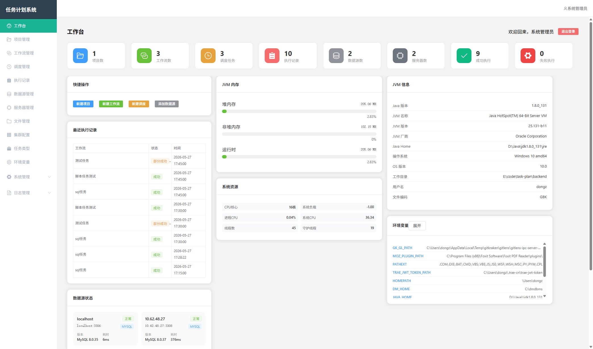
- 展示系统概览、服务器状态、数据源状态
- 快捷操作入口、最近执行记录
- JVM资源使用状态监控

### 工作流设计

- 可视化DAG工作流设计器，支持拖拽式任务节点添加
- 节点间依赖关系连线配置
- 双击节点打开编辑面板，支持多任务类型配置

### 工作流管理
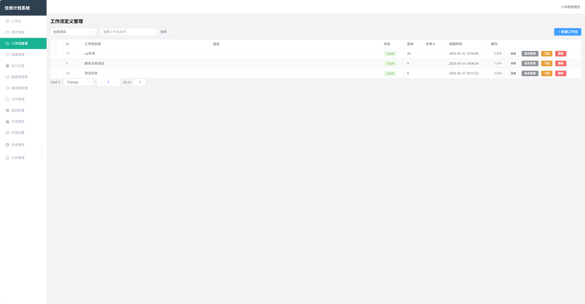
- 工作流列表展示与搜索
- 版本管理，支持版本对比与回滚
- 工作流创建、编辑、删除操作

### 调度管理
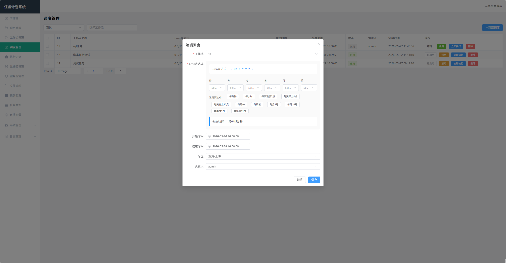
- Cron表达式调度配置
- 图形化Cron编辑器，可视化配置调度时间
- 调度状态控制（启用/禁用），支持立即执行

### 执行管理
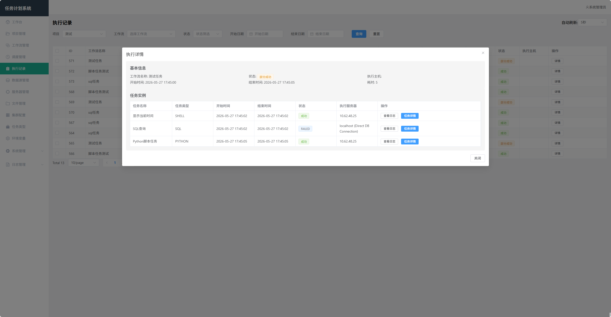
- 工作流实例状态监控
- 任务节点执行情况追踪
- 执行日志查看与详情展示

### 任务类型配置
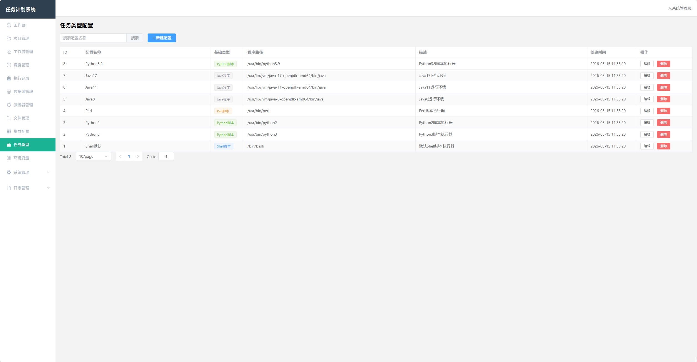
- 支持多种任务类型：Shell、Python、Java、SQL、Spark、Flink、HTTP等
- 任务类型参数配置管理

### 数据源配置
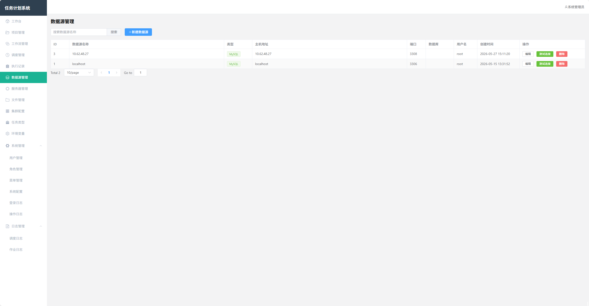
- 支持MySQL、PostgreSQL、Oracle等多种数据库
- 数据库连接测试验证
- 显示数据库类型、版本、当前时间

### 服务器管理
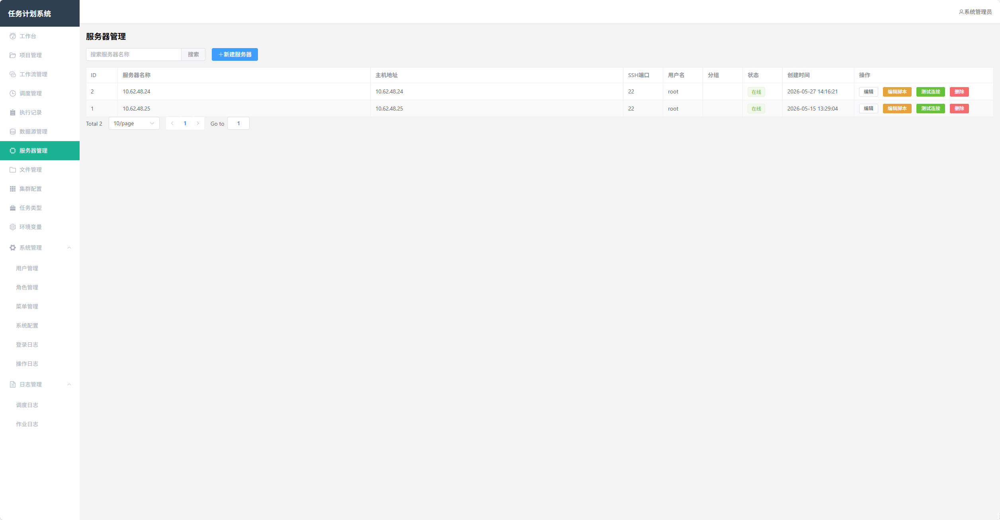
- SSH服务器连接配置
- 服务器状态监控
- 远程执行脚本支持

### 集群配置
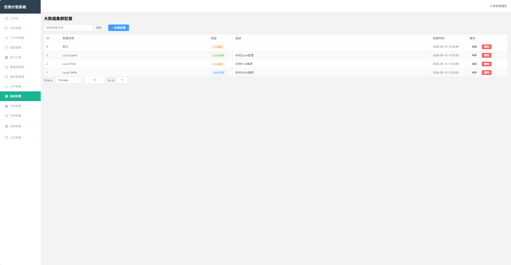
- 集群节点管理
- 分布式任务调度配置

### 项目管理
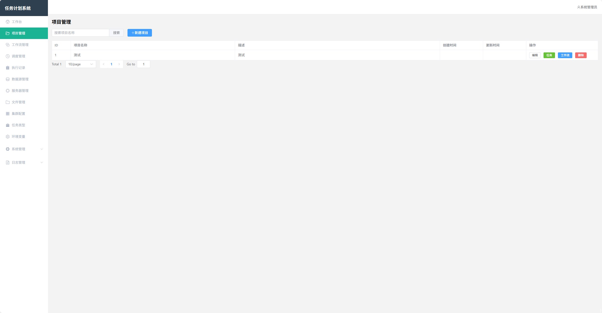
- 项目创建与配置
- 项目权限管理

### 文件管理
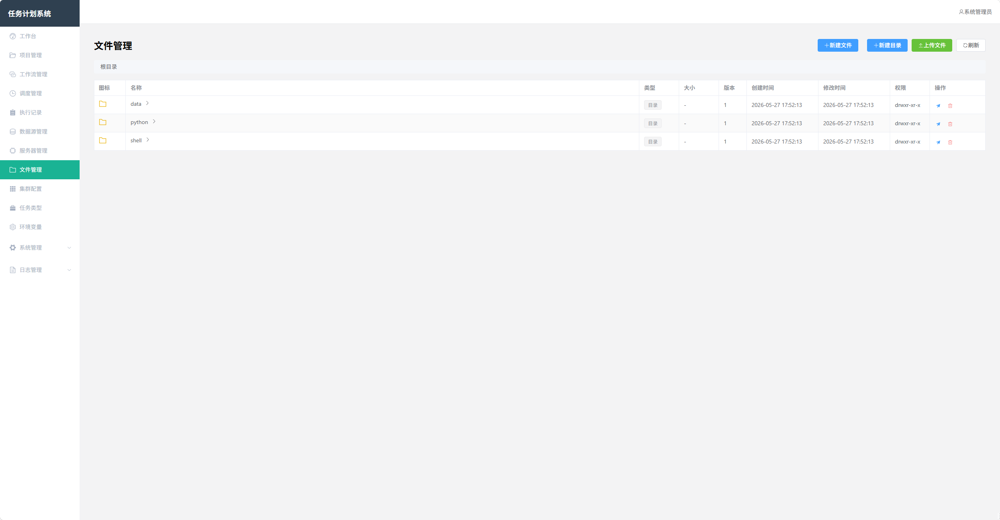
- 目录树展示
- 文件上传、预览、在线编辑
- 支持任意路径创建文件

### 环境变量配置
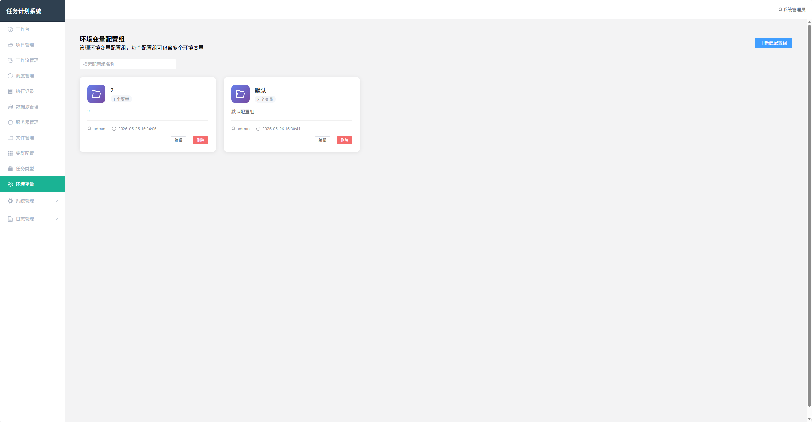
- 多组配置值管理
- 支持配置名称分组
- 环境变量替换功能

### 操作日志
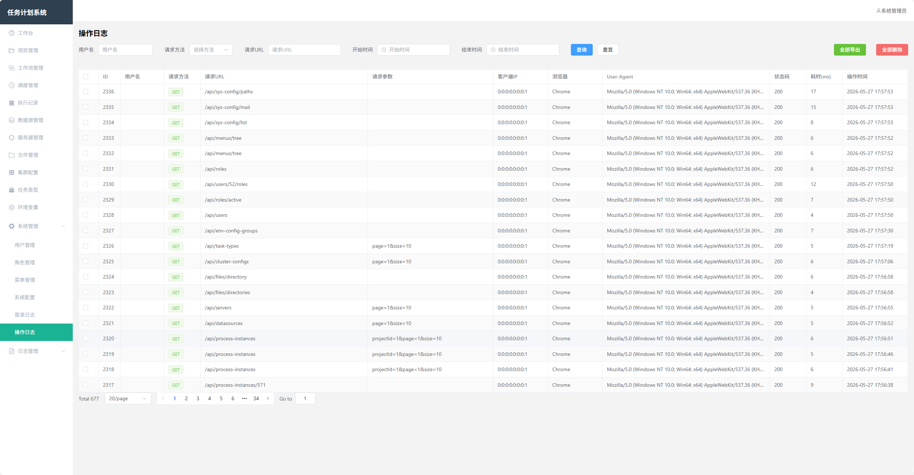
- 用户操作记录追踪
- 支持按条件搜索、导出、删除
- 记录HTTP Header中的User-Agent信息

### 调度日志
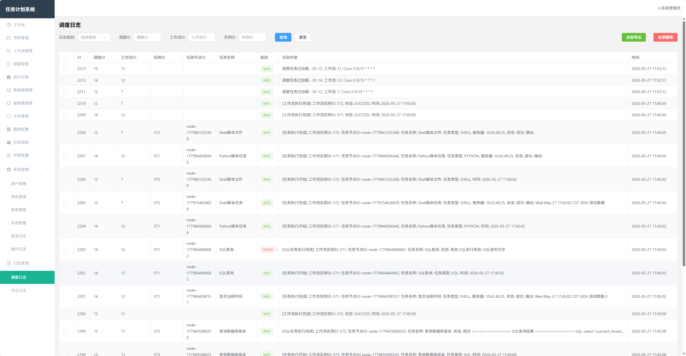
- 调度计划执行记录
- 支持实例ID查询条件
- 导出与删除功能

### 任务执行日志
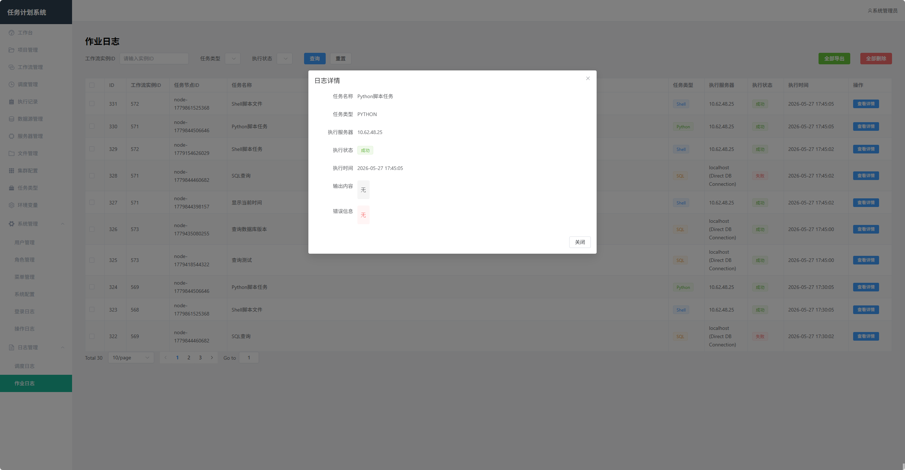
- 任务执行输出日志
- 日志详情查看
- 支持导出功能

### 系统配置
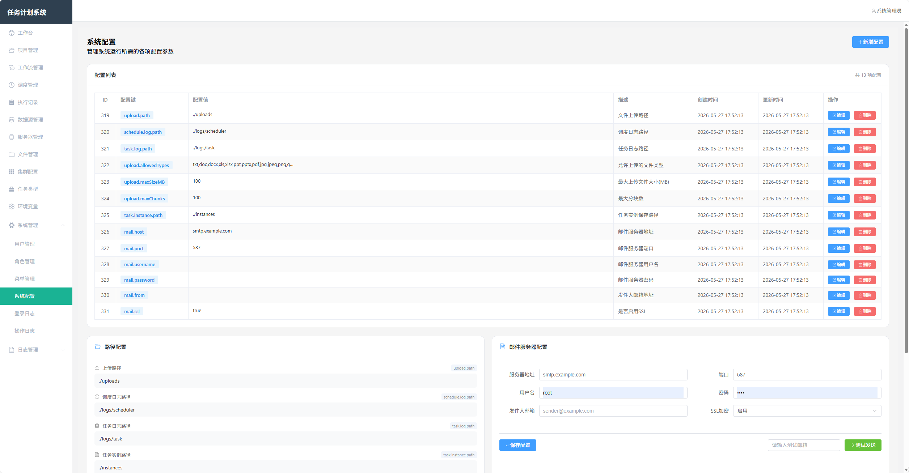
- 系统参数配置管理
- 邮件服务器配置与测试发送
- 文件上传类型配置

---

## ✨ 核心功能模块

### 1. 工作流设计模块
- **可视化DAG工作流设计器**：拖拽式任务节点添加
- **任务节点连线**：支持节点间依赖关系配置
- **任务详情编辑**：双击节点打开编辑面板
- **多任务类型支持**：Shell、Python、Java、SQL、Spark、Flink、HTTP等
- **脚本文件选择**：支持从文件管理中选择脚本文件
- **版本管理**：工作流版本自动递增、历史版本对比与回滚

### 2. 任务管理模块
- 任务定义管理（创建/编辑/删除）
- 任务类型配置管理
- 脚本文件管理（上传/预览/编辑）
- 数据源配置管理（MySQL、PostgreSQL、Oracle等）
- 环境变量配置管理

### 3. 调度管理模块
- **Cron表达式调度**：支持标准Quartz 6-field格式
- **图形化Cron编辑器**：可视化配置调度时间
- **调度计划管理**：创建、编辑、删除调度计划
- **调度状态控制**：启用/禁用调度，同步Quartz调度计划
- **立即执行**：手动触发工作流执行
- **执行日志查看**：查看调度执行记录

### 4. 执行管理模块
- **工作流实例管理**：查看实例状态、执行时间
- **任务实例管理**：查看各任务节点执行情况
- **执行日志追踪**：完整的任务执行日志记录
- **失败重试机制**：支持失败任务重试
- **远程执行**：支持SSH远程服务器任务执行

### 5. 资源管理模块
- **项目管理**：项目创建、配置
- **文件资源管理**：目录树展示、文件上传、在线编辑
- **环境变量配置**：多组配置值管理、支持配置名称分组

### 6. 系统管理模块
- **用户管理**：CRUD操作、角色分配
- **角色管理**：角色创建、权限配置
- **菜单管理**：动态菜单配置
- **服务器节点管理**：SSH连接配置、状态监控
- **系统配置管理**：系统参数配置

### 7. 日志管理模块
- **登录日志**：用户登录记录，支持导出、删除
- **操作日志**：用户操作记录，支持导出、删除
- **调度日志**：调度计划执行记录，支持实例ID查询
- **任务执行日志**：任务执行输出日志

---

## 📁 项目结构

```
task-plan/
├── backend/                              # 后端Spring Boot项目
│   ├── src/main/java/com/taskplan/       # Java源码
│   │   ├── controller/                   # REST API控制器
│   │   ├── service/                      # 业务逻辑层
│   │   ├── repository/                   # 数据访问层
│   │   ├── entity/                       # JPA实体
│   │   ├── config/                       # 配置类
│   │   ├── exception/                    # 异常处理
│   │   └── utils/                        # 工具类
│   ├── src/main/resources/               # 配置文件
│   ├── uploads/                          # 文件上传目录
│   └── pom.xml                           # Maven配置
├── frontend/                             # 前端Vue项目
│   ├── src/
│   │   ├── views/                        # 页面视图
│   │   ├── components/                   # 公共组件
│   │   ├── layout/                       # 布局组件
│   │   ├── router/                       # 路由配置
│   │   ├── api/                          # API接口定义
│   │   └── utils/                        # 工具函数
│   └── package.json                      # npm依赖
├── docs/                                 # 文档目录
│   ├── design.md                         # 设计文档
│   ├── api.md                            # API文档
│   ├── usage.md                          # 使用说明
│   ├── test-cases.md                     # 测试案例
│   ├── 开发计划.md                       # 开发计划
│   └── sql/                              # SQL脚本目录
│       ├── schema.sql                    # 数据库表结构脚本
│       └── data.sql                      # 初始化数据脚本
├── images/                               # 截图目录
└── README.md                             # 项目说明
```

---

## 🚀 快速开始

### 前置要求

- JDK 1.8+
- Node.js 18+
- MySQL 5.7+ 或 MySQL 8.0+

### 数据库配置

#### 方式一：使用SQL脚本初始化（推荐）

1. 创建数据库：
```sql
CREATE DATABASE task_plan CHARACTER SET utf8mb4 COLLATE utf8mb4_unicode_ci;
```

2. 执行表结构脚本：
```bash
mysql -u username -p task_plan < docs/sql/schema.sql
```

3. 执行初始化数据脚本：
```bash
mysql -u username -p task_plan < docs/sql/data.sql
```

#### 方式二：自动初始化

启动后端服务时，系统会自动初始化数据库表结构和基础数据。

**注意**：自动初始化仅在表不存在时执行，不会覆盖已有数据。

### 数据库连接配置

编辑 `backend/src/main/resources/application.yml`：

```yaml
spring:
  datasource:
    url: jdbc:mysql://localhost:3306/task_plan?useUnicode=true&characterEncoding=utf8&serverTimezone=Asia/Shanghai
    username: your_username
    password: your_password
    driver-class-name: com.mysql.cj.jdbc.Driver
```

### 初始化内容说明

| 初始化项 | 说明 |
|----------|------|
| **管理员账号** | admin / 123456 |
| **系统角色** | ADMIN(系统管理员), USER(普通用户) |
| **系统菜单** | 完整的菜单树结构 |
| **系统配置** | 文件上传、日志路径、邮件配置等 |
| **任务类型** | Shell、Python、Java、SQL、HTTP、Spark、Flink等 |
| **集群配置** | 本地单机、YARN、Flink集群 |
| **默认项目** | 系统默认项目 |
| **环境变量组** | 默认配置组、开发环境、生产环境 |

### 后端启动

```bash
cd backend
mvn spring-boot:run
```

服务启动后访问：http://localhost:8080

### 前端启动

```bash
cd frontend
npm install
npm run dev
```

前端启动后访问：http://localhost:3000

### 默认账号

- 用户名：admin
- 密码：123456

---

## 🔌 API接口说明

完整的API文档请参考：[docs/api.md](docs/api.md)

### 认证接口
| 接口 | 方法 | 描述 |
|------|------|------|
| `/api/auth/login` | POST | 用户登录 |
| `/api/auth/logout` | POST | 用户登出 |
| `/api/auth/userinfo` | GET | 获取当前用户信息 |

### 工作流接口
| 接口 | 方法 | 描述 |
|------|------|------|
| `/api/process-definitions` | GET | 获取工作流列表 |
| `/api/process-definitions` | POST | 创建工作流 |
| `/api/process-definitions/{id}` | GET | 获取工作流详情 |
| `/api/process-definitions/{id}` | PUT | 更新工作流 |
| `/api/process-definitions/{id}` | DELETE | 删除工作流 |

### 调度接口
| 接口 | 方法 | 描述 |
|------|------|------|
| `/api/process-schedules` | GET | 获取调度列表 |
| `/api/process-schedules` | POST | 创建调度 |
| `/api/process-schedules/{id}/enable` | POST | 启用调度 |
| `/api/process-schedules/{id}/disable` | POST | 禁用调度 |

### 日志接口
| 接口 | 方法 | 描述 |
|------|------|------|
| `/api/login-logs/export` | POST | 导出登录日志 |
| `/api/operation-logs/export` | POST | 导出操作日志 |
| `/api/schedule-logs` | GET | 查询调度日志 |
| `/api/task-execution-logs` | GET | 查询任务执行日志 |

---

## 🔒 安全特性

- JWT无状态认证
- 基于角色的访问控制(RBAC)
- 密码加密存储(BCrypt)
- 请求频率限制
- SQL注入防护
- XSS攻击防护

---

## 📖 文档目录

| 文档 | 路径 | 说明 |
|------|------|------|
| API文档 | [docs/api.md](docs/api.md) | 完整的API接口说明 |
| 设计文档 | [docs/design.md](docs/design.md) | 系统架构与设计说明 |
| 使用说明 | [docs/usage.md](docs/usage.md) | 用户操作指南 |
| 测试案例 | [docs/test-cases.md](docs/test-cases.md) | 测试用例文档 |
| 需求文档 | [需求.md](需求.md) | 完整需求说明 |

---

## 📝 开发指南

### 代码规范

- Java代码遵循阿里巴巴Java开发手册
- TypeScript代码遵循Airbnb风格指南
- 提交信息遵循Conventional Commits规范

### 开发流程

1. Fork项目
2. 创建功能分支
3. 开发并测试
4. 提交Pull Request
5. Code Review
6. 合并到主分支

---

## 📄 许可证

MIT License

---

## 📧 联系方式

如有问题或建议，请提交Issue。

---

**文档版本**: v1.2  
**最后更新**: 2026-05-22

---

# 关于作者

> 源码猿（master336）—— 一个把「踩过的坑」写成「别人脚下的路」的技术作者。

## 一句话介绍

**源码猿（master336）**，现就职于**某公司**，担任**高级技术架构师 / 产品售前专家**（腾讯云开发者社区认证）。长期深耕 Java 后端与分布式架构，近年将主要精力投向 **AI Agent、大模型私有化部署与工程化落地**，坚持用「能跑通、可复现、讲原理」的标准写每一篇文章。

## 身份与平台

| 平台 | 主页 | 身份 / 荣誉 |
| --- | --- | --- |
| CSDN 博客 | [master336.blog.csdn.net](https://master336.blog.csdn.net) | 人工智能领域**新星创作者**，原力等级 **298**，累计获赞 **461** 次、评论 **86** 条 |
| 腾讯云开发者社区 | [cloud.tencent.com/developer/user/1558800](https://cloud.tencent.com/developer/user/1558800) | 认证作者 · 某公司｜高级技术架构师、产品售前专家 |

## 技术视野

作者的写作版图横跨「从底层到应用、从传统工程到 AI 原生」的完整链路：

- **后端与架构**：Java、Spring / SpringBoot / SpringCloud、微服务架构、Maven
- **数据与存储**：MySQL、Redis、PostgreSQL、Greenplum、GaussDB、ETL 与大数据处理
- **运维与基础设施**：Linux、Nginx、操作系统、网络协议（TCP/UDP、HTTP/HTTPS、OSI 七层模型）、RabbitMQ
- **前端与客户端**：JavaScript、CSS、Vue.js、HTML、Android、微信小程序
- **AI 与智能化**：机器学习、NLP、图像处理、数据分析、AIGC
- **AI 工程化（近期主线）**：AI Agent 架构与多智能体协同、Ollama / ComfyUI 私有大模型部署、MCP 协议、Skill 资产化、大模型评测与上下文召回

## 写作风格

不同于「Hello World 式」的速食教程，作者的文章有三个鲜明特点：

1. **讲透原理** —— 不满足于告诉你「怎么做」，更在意解释「为什么这么做」；
2. **给出可落地的工程** —— 完整目录结构、核心代码、硬件选型、避坑清单，拿来就能改；
3. **有数据、有出处** —— 明确区分哪些是实测、哪些是预测、哪些不可横向比较，拒绝拍脑袋结论。

近期在腾讯云开发者社区连续产出《用 CodeArts 把一个自托管云相册真正做完》《Ollama 私有大模型部署与生态配置完全指南》《从零构建 AI Agent：一份写给工程师的深度开发指南》《一次讲透 HTTP 与 HTTPS》等长文，几乎保持日更节奏。

## 联系方式

- CSDN：[https://master336.blog.csdn.net](https://master336.blog.csdn.net)
- 腾讯云开发者社区：[https://cloud.tencent.com/developer/user/1558800](https://cloud.tencent.com/developer/user/1558800)

---

## ☕ 支持作者

看到这里，说明你已经陪我读到了文章的最后。

如果这些文字曾经帮你**少踩一个坑、少熬一个夜、少走一次弯路**，那它就是有价值的。写作这件事，靠的不只是兴趣，还有一台够用的机器、几个付费的实验环境、以及愿意花在查证与实测上的时间。

**你的每一份支持，都会变成下一篇文章里的一个真实实验、一次更深入的拆解。**

> 不用有压力 —— 一杯咖啡的钱，就足够让我开心很久。
> 当然，一个点赞、一条评论、一次转发，同样是最好的鼓励。

### 打赏渠道

<div align="center">

| 微信支付 | 支付宝 |
| :---: | :---: |
|  |  |
| *推荐使用微信支付* | *支持信用卡 / 花呗付款* |

</div>

### 不打烊的支持方式

如果不方便打赏，下面这些同样珍贵：

- 👍 **点赞** —— 让更多人看到这篇内容
- ⭐ **收藏** —— 下次要用时能第一时间找到
- 💬 **评论** —— 你的问题常常是下一篇选题的起点
- 🔗 **转发** —— 把有用的东西分享给需要的朋友

感谢每一位读到这里的人。我们下篇文章见。

---

*Made with ❤️ by 源码猿（master336）*
